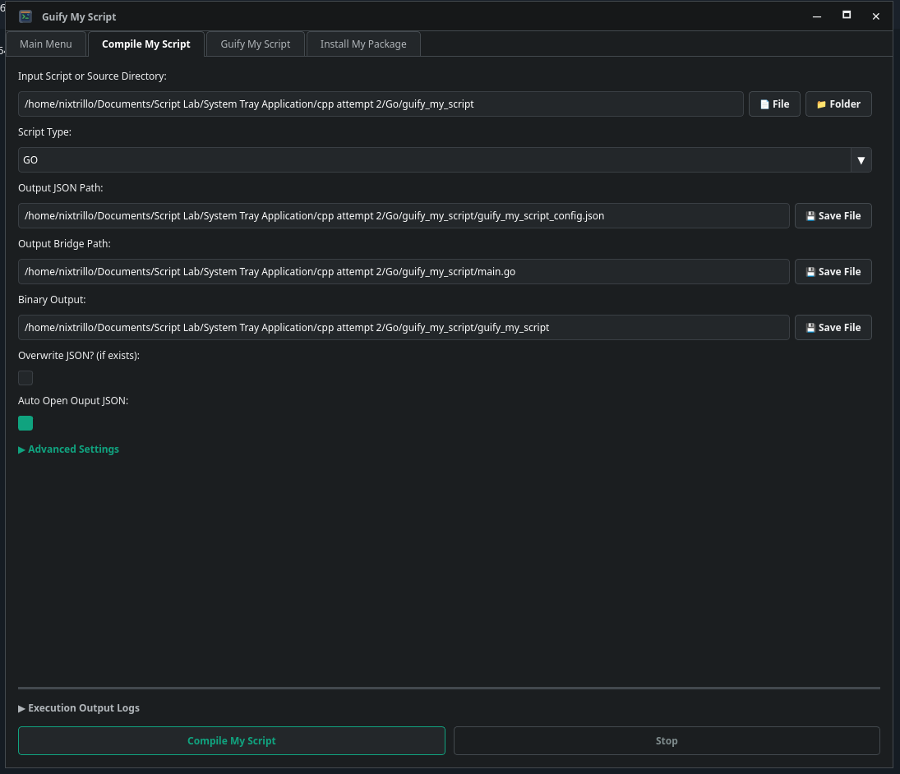

# Guify My Script

Guify My Script is a tool for wrapping a script or source project executable into a desktop application with a generated GUI. In practice, it is used to:

- generate a JSON configuration for a GUI frontend
- create the C++/Qt GUI code from that config
- build and package the resulting application
- install the packaged app on the current Linux system

This is useful when you aren't requiring a complex gui for your script but you still want to expose a script or command-line tool as a friendly desktop app and have input fields such as dropdowns, file pickers, date pickers etc...

## Table of contents

- [Supported script languages](#supported-script-languages)
- [1. Compile My Script](#1-compile-my-script)
- [2. Guify My Script](#2-guify-my-script)
- [3. Install My Package](#3-install-my-package)
- [Typical workflow](#typical-workflow)

## Supported script languages

The project is designed to work with source projects and scripts written in these common languages:

- Go (Input Script or Source Directory)
- Rust (Input Script or Source Directory)
- Shell scripts (Input Script Only)
- Python (Input Script Only)
- JavaScript / Node.js (Input Script Only)
- PowerShell (Input Script Only)

For Go and Rust projects, the tool can generate a bridge and compile the project directly. Go and Rust can also be compiled as a single input script (if a single script is selected then it will promote this to a Source Directory and generate the minimum  neccessary boilerplate in order to compile it) 

For the other script types, it can generate the GUI config from the script and then build the desktop app around that workflow.

Note: For the GUI to be able to pass values to the script, try to use primative types like integer / string / boolean. if you need to send multiple values under a single input then the gui tends to send these as CSV (i.e. "1","2","3").

---

## 1. Compile My Script

This action generates the JSON configuration that describes the app and its input fields. It is the first step in creating a GUI wrapper around a script or project.

### What it does

It takes an input script or project directory and produces:

- a JSON config file describing the GUI
- a bridge file for Go or Rust code integration
- optionally a compiled binary for the generated app

### Typical usage

In the generated GUI, use the tab named "Compile My Script".

The action contains these parameters:

- Input Script or Source Directory
  - The script file or project folder to wrap.
  - Example: a Go project, Rust project, or a script such as a shell, Python, or JavaScript file.

- Script Type (Source Directories only)
  - The language of the source being wrapped. The app will try to auto detect this based on the directory chosen.
  - Supported values: GO or RUST.
  - This tells the tool how to generate the bridge and metadata files correctly.

- Output JSON Path
  - Where the generated GUI config JSON should be saved.
  - This is the file that gets fed into the GUI generator.

- Exclude Packages (Source Directories only)
  - Optional package / cargo names to omit from the generated bridge.
  - Useful when you want to skip unrelated modules or libraries.

- Output Bridge Path (Rust / GO only)
  - The file where the generated bridge code should be written. The generated bridge will automatically be generated with all known public functions exposed by packages / cargo within the project.
  - This connects your source code to the GUI interface. (main.go / main.rs by default)

- Binary Output (RUST / GO only)
  - The name or path of the compiled app binary.
  - If left empty, the tool will choose a sensible default.

- Compile? (RUST / GO only)
  - If enabled, the project is compiled after the bridge and config are generated. (True by default)
  - This produces a runnable binary for the app which should be referenced in the JSON file.

- Overwrite JSON? (if exists)
  - If checked, the output JSON file can be overwritten if it already exists.

- Auto Open Output JSON
  - Opens the generated JSON file automatically after creation.
    NOTE: You will want to edit this so the fields match your intended inputs. Take the time to read the JSON schema and understand what should be entered here.

### Result

After this step, you should have a valid JSON config file that describes the GUI actions, input fields, and runtime behavior of the generated application. If you haven't already make sure to edit the generated JSON file with your expected field types / descriptions / names etc...

Once the JSON is ready, you can proceed to the next step.

---

## 2. Guify My Script

This action takes the generated JSON config and turns it into the actual GUI application source code and build artifacts.

### What it does

It reads the JSON config, builds the Qt/C++ interface, and prepares the app to be compiled and packaged.

The action contains these parameters:

- JSON Config Path
  - The path to the JSON config file produced by the "Compile My Script" step.

- Compile Mode
  - Controls whether the generated GUI is built in debug or production mode.
  - Valid values:
    - debug
    - production (distribution package)

- Clear Dependency Cache?
  - Removes cached dependencies before generating the GUI.
  - This helps if dependencies may be stale or inconsistent.

- Target Builds
  - A list of package targets to build for. (Currently supports Linux ARCH / DEBIAN / FEDORA package managers)
  - Supported examples:
    - .pkg.tar.zst_linux_amd64
    - .deb_linux_amd64
    - .rpm_linux_amd64
    - .pkg.tar.zst_linux_aarch64
    - .deb_linux_aarch64
    - .rpm_linux_aarch64

### Result

This step produces the GUI executable and creates package artifacts (if production was selected earlier) for installation or distribution.

---

## 3. Install My Package

This action installs a built package on the current system. Can be used to install the packages created in the previous tab.

### What it does

It validates the package file, detects the current Linux package manager, and installs the package using the appropriate system command for your distro.

The action contains these parameters:

- Pkg Path
  - The full path to the package file to install.
  - Supported package types include:
    - .pkg.tar.zst
    - .pkg.tar.xz
    - .deb
    - .rpm
    - .apk

- Update First
  - If enabled, the system package database is updated before installing the package.

### Result

The app or package is installed on the machine using the correct package manager for the OS. 

---

## Typical workflow

1. Prepare a script or source project.
2. Use "Compile My Script" to generate the JSON config.
3. The generated JSON contains all of the actions extracted from functions within the targeted script or project, this will need to be edited to match what the input parameter expects. (I recommend a text editor that supports reading JSON schemas for this step)
4. Use "Guify My Script" to generate the desktop GUI code and build targets.
5. Use "Install My Package" to install the resulting package.
6. Enjoy your app.
